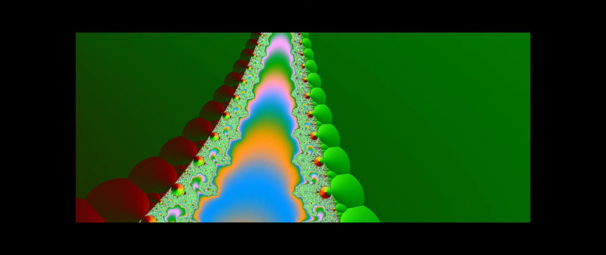
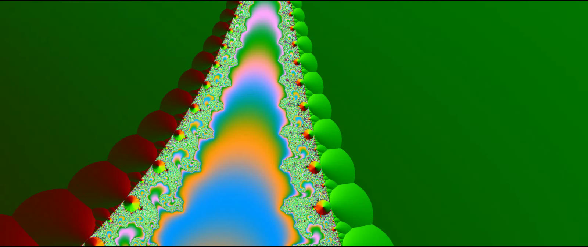
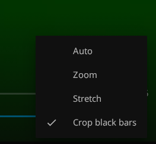
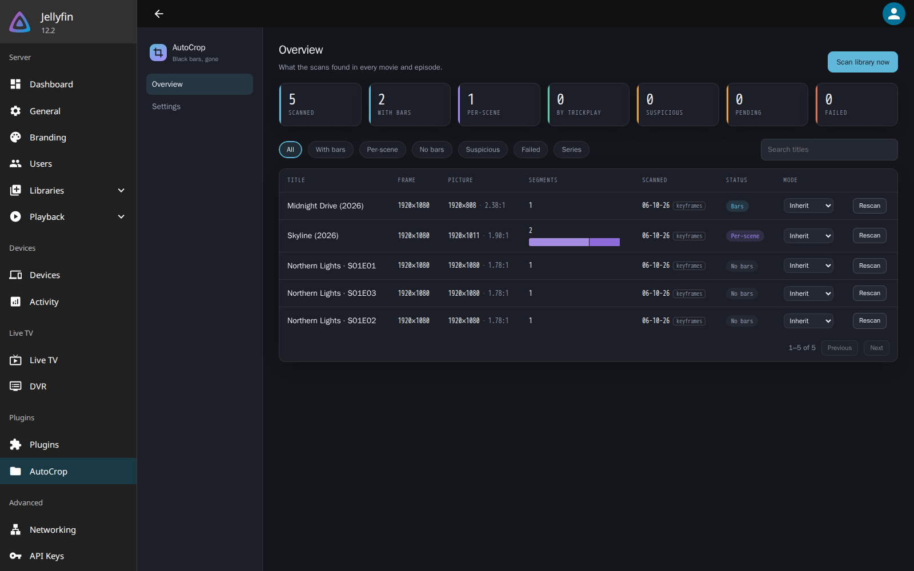
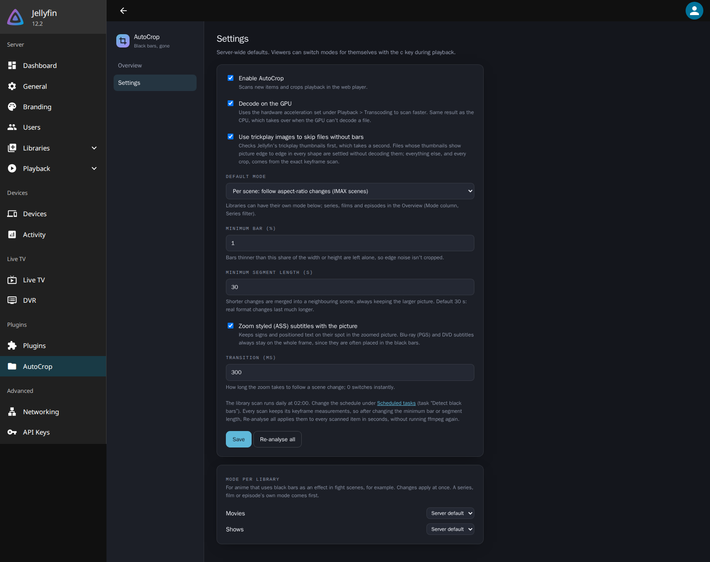

# AutoCrop for Jellyfin

Removes black bars that are burned into the video itself, so the picture fills your screen in Jellyfin's web player.

Some files store their black bars inside the video: a widescreen film saved as a 16:9 frame with black rows above and below. On a 16:9 TV you won't notice, but on an **ultrawide (21:9) monitor** you get black bars on every side. Jellyfin's own Zoom and Stretch options can't fix that, because they don't know where the picture is. AutoCrop measures every file once and zooms the player so only the real picture fills the screen.

| Without AutoCrop | With AutoCrop |
| --- | --- |
|  |  |

## Features

- **Exact.** Every file is measured, so nothing is guessed.
- **One crop per film.** Nothing switches mid-film. A film that cuts between widescreen and taller IMAX scenes plays in its widescreen shape throughout, as a regular cinema shows it, or with the whole picture and bars in the widescreen scenes; your choice.
- **Only zooms when it helps.** On a normal 16:9 screen nothing changes.
- **Works in the background.** New films and episodes are measured automatically, usually in about a second.
- **Dashboard** with everything it found, plus settings.

## Install

1. In Jellyfin, open **Dashboard → Plugins → Repositories** and add:
   ```
   https://github.com/WouterStulp/jellyfin-plugin-autocrop/releases/latest/download/manifest.json
   ```
2. Install **AutoCrop** from the catalog and restart Jellyfin.
3. Reload Jellyfin in your browser.

The first scan of your library runs in the background. Most files are done in a second; files with black bars take up to a minute or two each. Works with Jellyfin 10.11.9 and newer, including 12.x.

## Using it

While watching in the browser, open the **⚙ settings → Aspect Ratio** and choose **Crop black bars**. Choose **Auto**, **Zoom** or **Stretch** to turn it off again. This is remembered in that browser, for everything you watch.



While it's on, each film or episode plays in the mode the server sets for it: films in the theatre crop, series in the whole picture. Press **C** during playback to switch between:

| Mode | What you see |
| --- | --- |
| **Theatre crop** | One crop, cut to the film's widescreen shape. IMAX scenes lose their extra height, as in a regular cinema. |
| **Whole picture** | One crop that never cuts picture. Only bars present in every frame go; a film with IMAX scenes keeps bars in its widescreen scenes. |
| **Off** | Normal playback. |

This choice is remembered in that browser for the whole series (or that film).

## Dashboard and settings

Go to **Dashboard → Plugins → AutoCrop**.



- **Overview:** every measured file with its picture size and shape. Search, filters, **Rescan** per file, and **Scan library now**.
- **Settings:**
  - the default mode for films (theatre crop) and for series (whole picture), and a mode per library
  - minimum bar size (1%)
  - zoom styled (ASS) subtitles with the picture (on)
  - GPU decoding (on)
  - use trickplay images to speed up scanning (on)

  After changing a setting, **Re-analyse all** applies it to everything in seconds.

<details><summary>Settings page</summary>



</details>
- **Mode per series, film or episode:** the **Mode** column in the overview, and the **Series** filter to set a whole series at once. Series play the whole picture by default because many anime use black bars as an effect in fight scenes (Black Clover, Jujutsu Kaisen), and the theatre crop would cut the rest of the episode down to them. Set a series that is letterboxed for real to **Theatre crop**.

  A file uses its own mode, else its series', else its library's, else the default mode.

Files marked **suspicious** gave a result that doesn't look like any real film shape, so AutoCrop leaves them uncropped.

## Limitations

- **Browser only.** It works in Jellyfin's web player (also inside apps that use it, like Jellyfin Media Player). Android TV, Swiftfin, Infuse and Kodi aren't supported.
- **Blu-ray (PGS) and DVD subtitles** stay on the whole, unzoomed frame, because they are often placed in the black bars. Styled ASS/SSA subtitles zoom with the picture, so signs stay on their spot (turn that off in the settings). Normal subtitles are fine.

## More

- [How it works](docs/how-it-works.md): detection, trickplay pre-check, the two crops, API and development.
- [MIT license](LICENSE)
